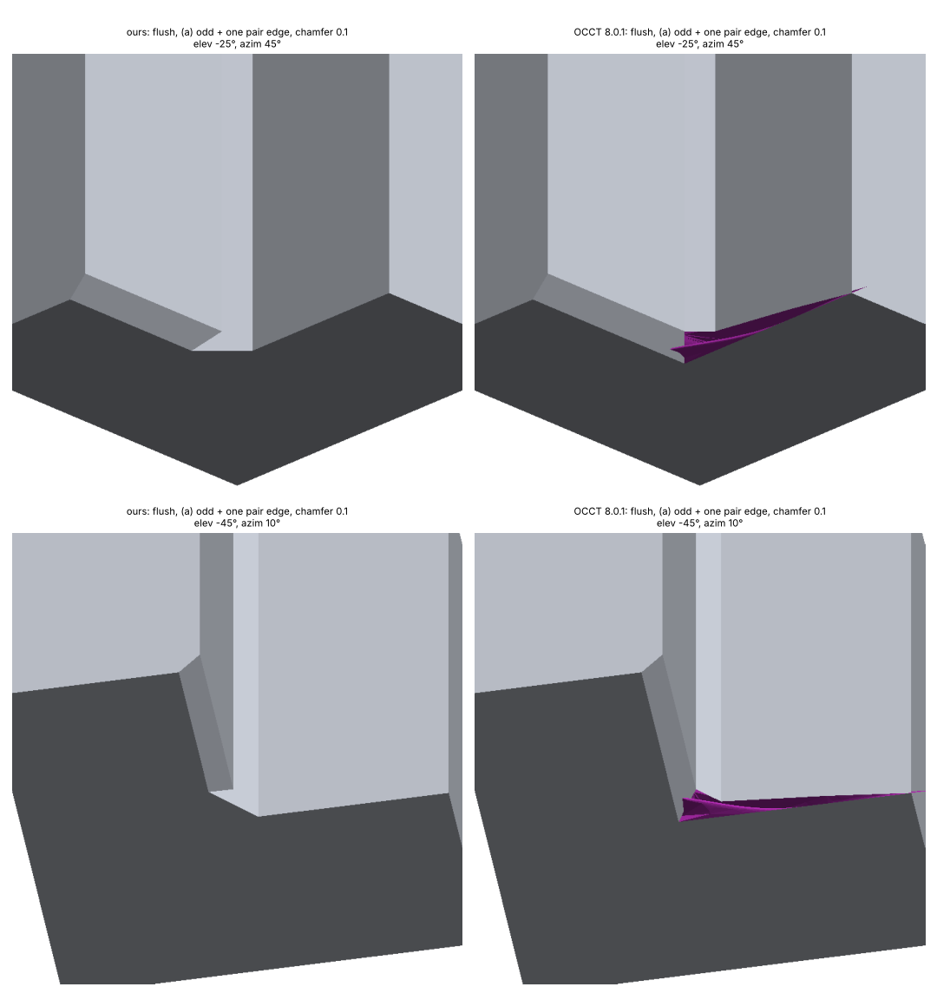
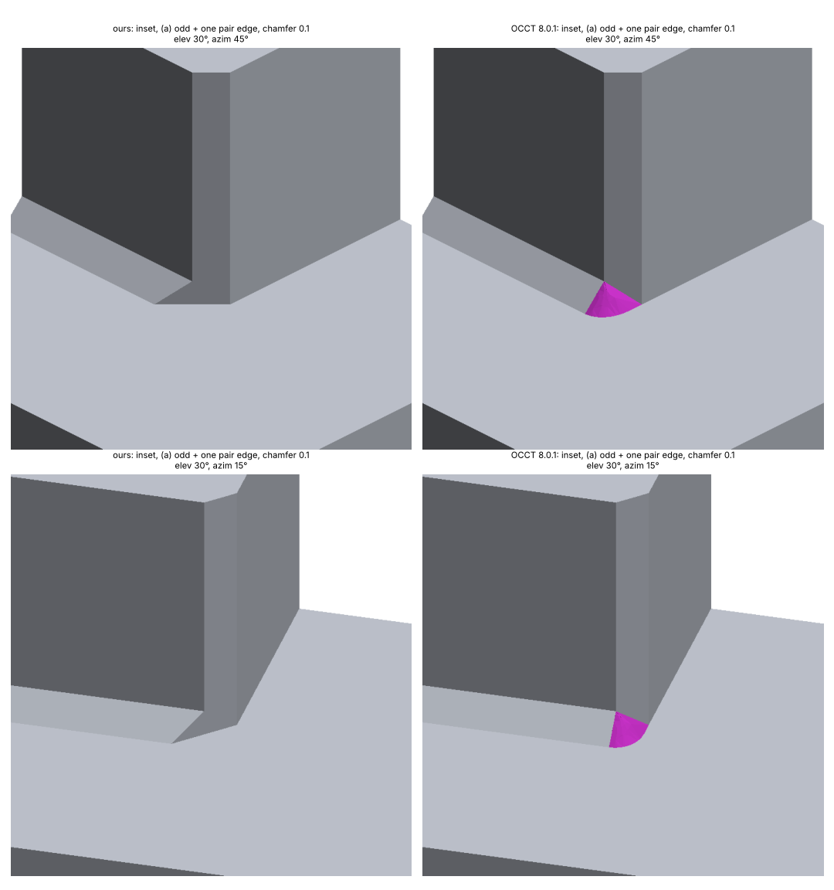
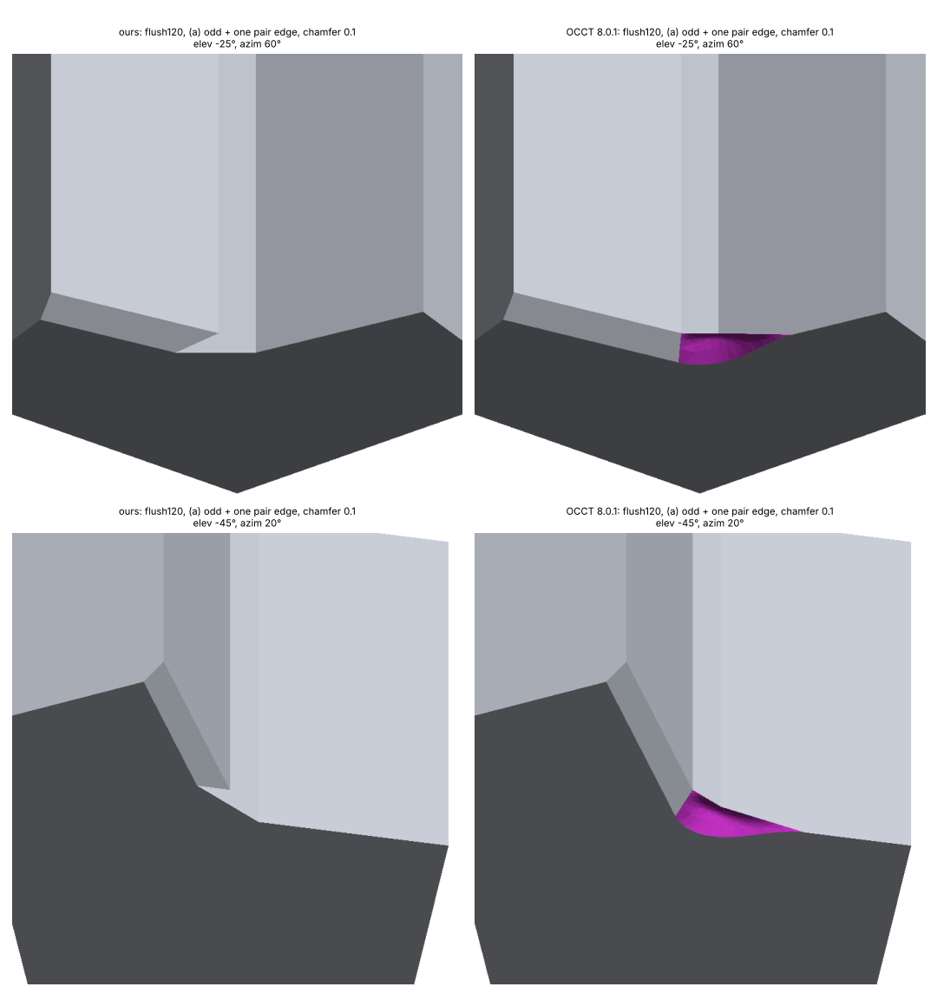
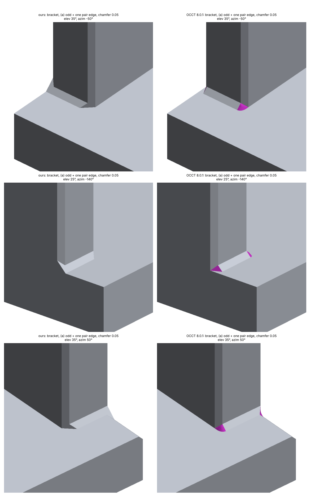
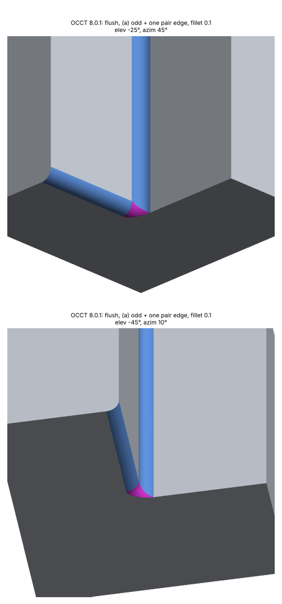
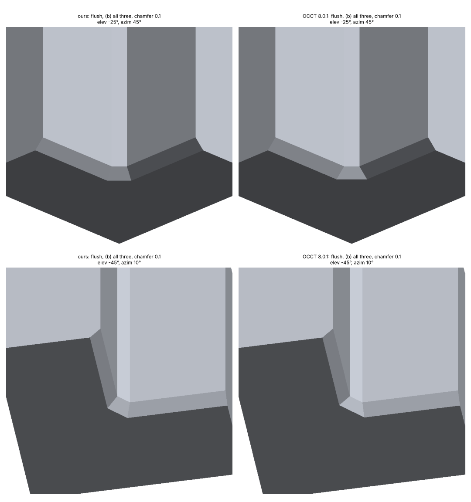
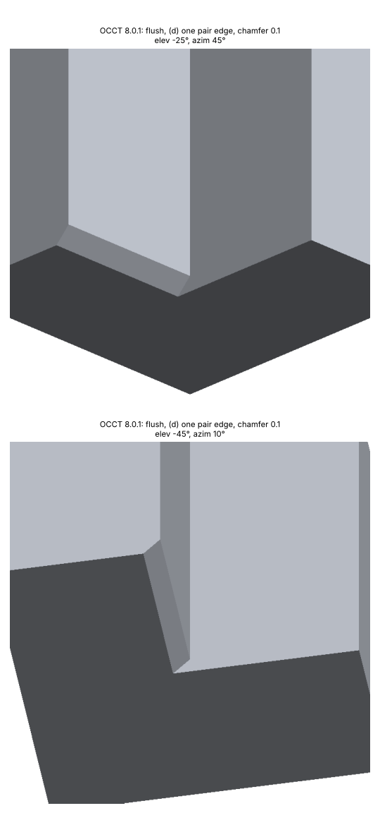

# The mixed corner in Open CASCADE

Ev asked on PR 7038 how its odd-plus-one chamfer compares with what other
kernels do. This page puts our kernel beside Open CASCADE (OCCT 8.0.1,
through `cadquery-ocp` 8.0.1.1.0) on the same four fixtures, under five
requests, chamfer and fillet, and lists what the commercial systems' public
documentation says.

## How it was measured

- **Fixtures**: `band_mixed_corner.rs`'s flush L (`flush`), inset boss
  (`inset`), the flush corner at a 120° plan angle (`flush_at(2π/3)`) and the
  bore-less bracket (`boreless`). OCCT builds them as box fusions (the 120°
  one as a polygon prism) merged by `ShapeUpgrade_UnifySameDomain`, with the
  same coordinates. `s = r = 0.1`, and `0.05` on the bracket.
- **Requests**: (a) the odd edge and one pair edge, PR 7038's; (b) all three,
  cut 1's; (c) the odd edge alone; (d) one pair edge; (e) both pair edges. On
  the bracket only (a), `bracket_request`, and (b), the nine edges at its
  four mixed corners: a root is the odd edge at one corner and a pair edge at
  the next, so (c) to (e) do not exist there.
- **OCCT**: `BRepFilletAPI_MakeChamfer` with `Add(s, edge)`, and
  `BRepFilletAPI_MakeFillet` with `Add(r, edge)`. A build is *valid* when
  `BRepCheck_Analyzer` passes and it is one solid with one shell.
- **Agreement**: ΔV, and point membership at 3000 seeded points in a box
  about the corner, 12000 on the bracket. Our side classifies them with
  `point_in_solid`, OCCT's with `BRepClass3d_SolidClassifier`.
- **Renders**: both kernels' tessellations, written as `draw_soup.py` soups
  and drawn by its rasterizer at PR 7038's viewpoints, ours on the left.
  Magenta is a face on a surface other than a plane, cylinder, torus or
  sphere, here always OCCT's B-spline corner patch.

`occt_compare_ours.rs` writes our side, `occt_compare.py` OCCT's, and
`occt_draw.py` the pictures; each file's header says how to run it.
`occt-compare/ours.tsv` and `occt-compare/occt.tsv` hold every row.

## Results

ΔV in units of 10⁻³. "Pts" counts the sample points on which the two
kernels disagree.

| Fixture | Request | Ours, chamfer | OCCT, chamfer | Pts | Ours, fillet | OCCT, fillet |
|---|---|---|---|---|---|---|
| flush | (a) | 5.6667 | **invalid**: two faces, two wires and the shell fail BRepCheck; ΔV 29.58 | — | refuses | 2.2294 |
| flush | (b) | 0.016751 (`K s³`) | 0.33333 (`s³/3`) | 15 | 0.016812 | 0.016812 |
| flush | (c) | 10.000 | 10.000 | 0 | 4.2920 | 4.2920 |
| flush | (d) | refuses (foot inside a face) | −5.0000 | — | refuses | −2.1460 |
| flush | (e) | −10.333 | −10.333 | 0 | −4.38791 | −4.38791 |
| inset | (a) | −0.66667 | −0.030137 | 27 | refuses | −0.082713 |
| inset | (b) | 4.9832 | 4.6667 | 14 | 2.1292 | 2.1292 |
| inset | (c) | −5.0000 | −5.0000 | 0 | −2.1460 | −2.1460 |
| inset | (d) | refuses | 5.0000 | — | refuses | 2.1460 |
| inset | (e) | 10.333 | 10.333 | 0 | 4.38791 | 4.38791 |
| 120° | (a) | 4.4489 | 1.3120, valid, but it gouges the floor beside the unrequested pair edge | 196 | refuses | −1.0363 |
| 120° | (b) | −1.3844 | −1.2341 | 3 | −3.2441 | −3.2441 |
| 120° | (c) | 8.6603 | 8.6603 | 0 | 1.0750 | 1.0750 |
| 120° | (d) | refuses | −4.9038 | — | refuses | −2.1183 |
| 120° | (e) | −10.192 | −10.192 | 0 | −4.3474 | −4.3474 |
| bracket | (a) | −5.0000 (`−2s²`) | −5.0455 | 148 | refuses | fails (`IsDone` false) |
| bracket | (b) | −3.7500 | −3.7500 | 62 | −1.6095 | −1.6095 |

- (c) and (e) agree to 10⁻¹⁵ for the chamfer, and to 10⁻⁹ for the fillet
  (OCCT's corner patch is approximated). All three fillets agree to 10⁻¹⁵ in
  (b).
- The (b) chamfers have the same topology, 12 faces at a single corner, but
  differ in the link. Ours is a strip mitred onto the pair's strips, and
  OCCT's is one planar cap of another plane. The bracket's ΔV agrees only
  because the flush and inset `s³` terms cancel in both kernels; 62 points
  disagree.

## The odd edge with one pair edge

OCCT runs each strip close to the vertex and closes the hole between their
ends with one non-planar B-spline patch. We extend the odd strip's plane down
to `E` and stop the pair strip there, so every face stays planar.

- **Flush, right angle**: the patch twists through itself and the solid fails
  BRepCheck. The odd strip also stops `s` above the floor.
  
- **Inset**: valid. The patch is a quarter-cone-like fan from the odd strip's
  foot to the pair's fill. It fills the triangle that we leave open.
  
- **Flush at 120°**: it passes BRepCheck, but the patch scoops material out
  of the floor beside the *unrequested* pair edge. About 2.6·10⁻³ of volume
  differs, and every disagreeing point is one OCCT reads as outside.
  
- **The bracket**: valid at all four corners, with a small patch at each.
  

The fillet that we refuse, OCCT builds at the single corners: the cylinders
join through a corner patch, the shape T-FLEX's help pictures (below). On the
bracket it fails.

## All three, and one pair edge alone

- **All three**: the same faces as ours, with a different link plane.
  
- **One pair edge alone**: OCCT ends the strip square in the plane of the odd
  edge's other face, extended. It is valid and planar; we refuse.
  

## What the commercial systems document

- **Creo Elements/Direct Modeling** (PTC), [Modify3D Chamfer](https://support.ptc.com/help/creo/ced_modeling/r20.2.0.0/en/ced_modeling/OSDM_Main/Modify3D_Chamfer.html),
  under Limitations: "You cannot create two chamfers that meet at a vertex,
  where one is concave and one is convex." Its
  [picture](https://support.ptc.com/help/creo/ced_modeling/r20.2.0.0/en/ced_modeling/images/ChamferLimitation1.png)
  highlights an L-block's reflex vertical and a top edge: request (a).
- **T-FLEX CAD** (built on Parasolid), [Main Concepts of Vertex Blend](https://www.tflex.com/help/eng/T-FLEX%20CAD/17/specifics_of_blending_sets_of_.htm):
  - "Blending a pair of edges of the opposite convexity is impossible for
    chamfers."
  - For fillets, "the vertex where the edges meet is automatically blended"
    ([figure](https://www.tflex.com/help/eng/T-FLEX%20CAD/17/roundinggroup7.png), right half: a notch's
    concave vertical fillet rolling over into its convex top-edge fillet).
  - With all three edges, the shape depends on a convex-first or
    concave-first processing order
    ([figure](https://www.tflex.com/help/eng/T-FLEX%20CAD/17/roundinggroup8.png)).
- **COMSOL Design Module**, [Chamfer](https://doc.comsol.com/6.3/doc/com.comsol.help.design/design_ug_function.5.40.html):
  a "Y-shaped chamfer" option, used "at a vertex where three or more edges
  meet and there are two chamfer surfaces of different convexity". The page
  adds: "In some cases, using this option is necessary for the operation to
  succeed." It does not describe the shape.
- **NX**: the edge blend API has a `ConvexConcaveY` flag, "Special blend at
  convex / concave Y", and an `OrderOfBlending` of `ConvexFirst` or
  `ConcaveFirst`
  ([EdgeBlendBuilder](https://docs.plm.automation.siemens.com/data_services/resources/nx/12/nx_api/custom/en_US/nxopen_python_ref/NXOpen.Features.EdgeBlendBuilder.html),
  which now redirects to the support portal). No public page describes the
  geometry.
- **Fusion**, [Chamfer reference](https://help.autodesk.com/cloudhelp/ENU/Fusion-Model/files/SLD-REF-CHAMFER.htm):
  the corner types Chamfer, Miter and Blend, for where beveled edges meet. It
  says nothing about mixed convexity.
- **SolidWorks** (Chamfer PropertyManager's "Keep features", fillets'
  "Overflow type"), **Onshape**, **CATIA**, **Creo Parametric** and **ACIS**:
  I found nothing public on this configuration.
